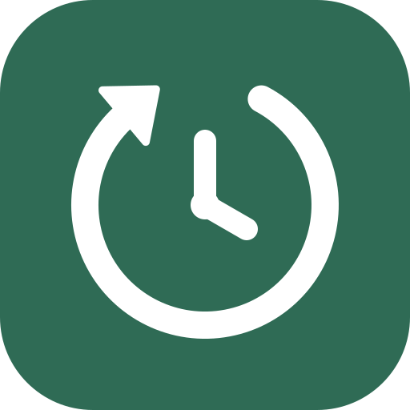
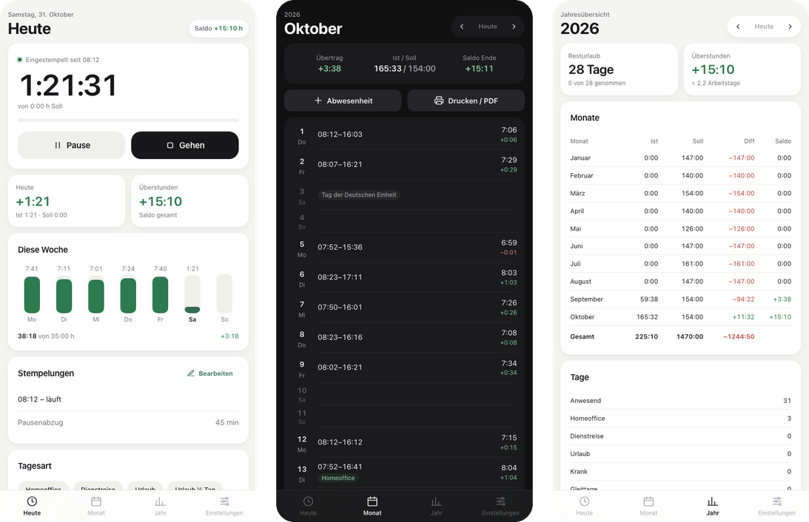

  

<h1 align="center">Clockwise</h1>

Time tracking for your working hours.

  <a href="https://feos7c5.github.io/Clockwise/"><b>Open Clockwise →</b></a>

  

## Features

- Clock in, take breaks and clock out with one tap
- Live timer that shows when you have reached your daily target
- Overtime balance across months and years
- Vacation, sick days, home office and business trips
- Public holidays for all German states
- Monthly time sheet as PDF and export for Excel
- Sync between your devices, end-to-end encrypted, no account needed
- Light and dark mode, English and German
- Works offline

## Install

**iPhone:** Open the link in Safari, tap **•••** → **Share** → **Add to Home Screen**.

**Mac:** Open the link in Safari, then **File** → **Add to Dock**. In Chrome or Edge, click **Install** in the address bar.

## Privacy

Your data stays on your device. There is no tracking. If you turn on sync, your data is encrypted
on your device before it leaves it.

## License

[MIT](LICENSE) © 2026 feos7c5
